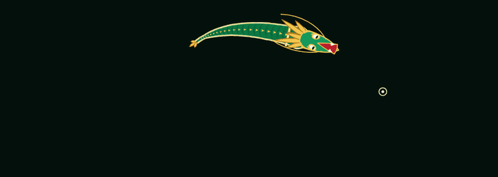

# cursor-critters

Procedural creatures that walk, turn and chase the mouse pointer on a `<canvas>`.

No dependencies, no build step, no framework. One JS file and one CSS file, about
**11.5 KB gzipped** together. Drop them on a page and a creature starts living in a box.



**[Live demo](https://rightkik.github.io/cursor-critters/)** &middot;
**[Live tuner](https://rightkik.github.io/cursor-critters/tuner.html)**

Two creatures ship with it, and a button swaps between them:

| mode | what it is |
| --- | --- |
| `cat` | a small cat drawn as solid rounded shapes, with a tapering tail and slit pupils |
| `naga` | a Thai temple serpent: emerald scales, a gold flame crest, an open red mouth and a flicking tongue |

> **It needs a mouse.** On a touch screen there is no hovering pointer to chase, so
> the library hides itself completely and costs the page nothing. That includes
> your browser's device-emulation mode &mdash; if the demo looks empty there, this
> is why, not a bug. See [When it does nothing](#when-it-does-nothing).

## Install

Copy `src/cursor-critters.js` and `src/cursor-critters.css` into your project.
There is nothing to install.

## Use

```html
<link rel="stylesheet" href="cursor-critters.css">

<div class="cursor-critter-stage">
  <canvas id="cursor-critter" class="cursor-critter-canvas" aria-hidden="true"></canvas>
  <button type="button" id="cursor-critter-swap" class="cursor-critter-swap">Reptile</button>
</div>

<script src="cursor-critters.js" defer></script>
```

That is the whole integration. The script finds the canvas by its id, sizes itself
to whatever box you put it in, and starts.

The button is optional. Leave it out and you get one creature with no way to swap;
include it and the script writes its own label and wires up its own click handler.

## API

Three globals, all optional.

```js
// Swap creatures. With no argument it toggles; returns the new mode name.
cursorCritterSwitch();        // -> 'naga'
cursorCritterSwitch('cat');   // -> 'cat'

// Which creature is on screen right now.
cursorCritterMode();          // -> 'cat'
```

The choice is remembered in `localStorage` under `cursor-critter-mode`, so a
visitor who picks one keeps it on their next visit. The default for a first-time
visitor is `cat`.

### Tuning

Set `window.CURSOR_CRITTER_OPTS` **before** the script loads to override the
built-in numbers. Anything you leave out keeps the creature's own default.

```html
<script>
  window.CURSOR_CRITTER_OPTS = {
    creature: 'naga',  // which creature to start with, ignoring localStorage
    drive: 0.11,       // how hard it drives at the pointer
    ease: 28,          // how fast joints ease toward their goal angle
    bend: 0.18,        // maximum bend of a single joint, in radians
    wave: 0.013,       // amplitude of the tail wave, scaled by speed
    seg: 52,           // number of body joints
    link: 5.4          // length of one joint, in pixels
  };
</script>
<script src="cursor-critters.js" defer></script>
```

`ease` is the one to reach for first: low values make the body languid and
liquid, high values make it snap. The **[live tuner](https://rightkik.github.io/cursor-critters/tuner.html)**
puts all six on sliders and prints the settings object for you to paste.

## What makes it move

The creature is not keyframed and follows no path. Everything below falls out of
the simulation, which is why it reads as an animal rather than an animation.

- **Traction.** The body can only accelerate as hard as its planted feet allow:
  `traction = 0.16 + (planted / total) * 0.84`. Lift several feet at once and it
  simply cannot speed up until they land, which produces a crouch&ndash;push&ndash;glide
  rhythm nobody had to author.
- **Inertia everywhere.** Forward speed is momentum, not an assignment. Turning
  accumulates force and then decays, so the creature leans into a corner before
  it can take it, and overshoots a little when it changes its mind.
- **Alignment drag.** It runs slower while it is still pointing the wrong way, so
  a sharp reversal costs it real time.
- **A wave down the spine.** Each joint eases toward its goal angle slightly
  slower than the one ahead of it (`rate = ease - i * 0.38`). That gradient is
  what makes the body flow head to tail instead of snapping into shape all at
  once, and it is the single biggest contributor to the way it looks.
- **Diagonal gait.** Feet step in diagonal pairs, planting where the ground is
  rather than sliding, and each step arcs and lifts on its way over.
- **A fixed 1/120s timestep.** The physics runs in fixed increments no matter how
  the frames fall, so the creature covers the same ground per second on a 60 Hz
  laptop and a 144 Hz monitor.

Leave the mouse alone for a second and a half and it stops waiting, wandering the
box on its own until you come back.

## When it does nothing

This is the part worth reading before you file an issue.

The stage is `display: none` by default and only becomes visible inside
`@media (hover: hover) and (pointer: fine)`. The script runs the same two tests
and returns before allocating anything. So on a phone, a tablet, or a browser in
device-emulation mode, **there is no box, no canvas work, and no animation** —
and because it is hidden rather than dimmed, the page is exactly as tall as it
would be without the library. Nothing shifts.

It also stands down completely under `prefers-reduced-motion: reduce`.

## Cost

- **~10 KB gzipped** for the JS and **~1.3 KB gzipped** for the CSS.
- Stops dead when the tab is hidden (`visibilitychange`) or when the canvas
  scrolls out of view (`IntersectionObserver`) — it never burns cycles you
  cannot see.
- `devicePixelRatio` is capped at 2, so a phone-class display does not quietly
  quadruple the fill area.
- No `shadowBlur`, which is the usual reason a canvas animation gets expensive.
- The canvas has a fixed CSS height, so attaching the script shifts no layout.
- `pointer-events: none` on the canvas: clicks pass straight through to whatever
  sits behind it.

Timed on a desktop browser over a 900×320 canvas, one physics substep plus a
full redraw costs about **0.24 ms** for `cat` and **0.55 ms** for `naga`. At
60 Hz that is 1.4% and 3.3% of the 16.7 ms frame budget.

## Browser support

Anything with `matchMedia`, `requestAnimationFrame` and canvas 2D — every current
browser. Older engines fail the feature test at the top of the file and the script
returns without touching the page.

## Styling

Three classes, and you can restyle all of them:

| class | what it is |
| --- | --- |
| `.cursor-critter-stage` | the box; sets the background and clips the creature |
| `.cursor-critter-canvas` | the canvas; its height decides how tall the box is |
| `.cursor-critter-swap` | the swap button, pinned bottom-right of the stage |

Changing the stage's `max-width` or the canvas height is safe — the creature
scales itself to the box it finds and reseeds on resize.

## License

MIT. See [LICENSE](LICENSE).

---

Built by rightkik &middot; [www.PRESS.in.th](https://www.press.in.th/)
